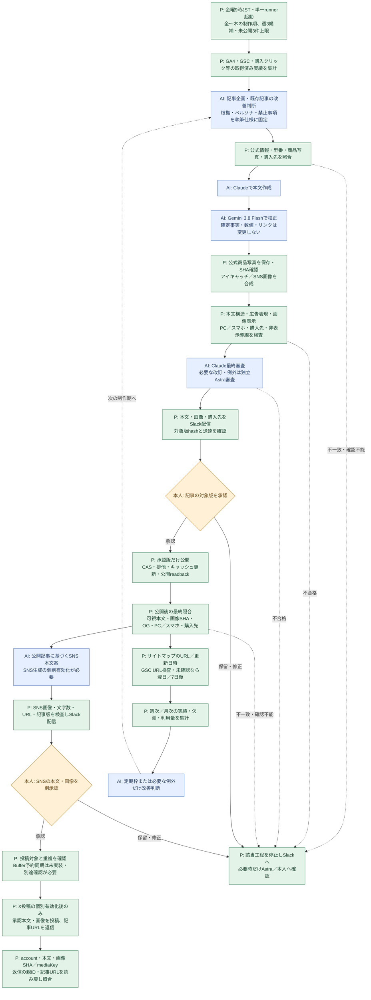

# Camp編集の通常進行と工程復旧

## 目標とする全体フロー

下図は再開後の目標。停止中には実行しない。Pはプログラム、AIは内容判断、本人は対象版の承認を示す。



SNSの待機は、公開済み記事の次の制作期を止めない。未公開記事の本人承認待ちと件数上限は維持する。
画像の基本は実商品の公式写真とプログラムによる合成。AIによる商品外観や未確認仕様の創作で置き換えない。
待機・同一状態・件数判定・旧記録照合にはAIを呼ばない。成功結果の再利用は依存入力hashが一致する場合だけ。
Buffer同期は未実装であり、空キューを推定しない。X停止中は承認済みSNSも投稿しない。

この変更は隔離ブランチで検証する。既存の本番設定・launchd・承認台帳を切り替える手順ではない。
停止中のCodex確認用automationを、この変更の導入やテストを理由に再開しない。

## 分担

deterministic構成では `socialGenerationEnabled`（SNS案生成）、`socialReviewEnabled`（SNS承認配信・取込）、
`socialPostingEnabled`（X投稿）を分ける。新しい前二者は未指定なら無効とし、再開範囲を明示する。
記事だけを再開する場合は三つともfalseを維持する。記事承認・公開フラグの有効化だけでSNSを進めない。

通常の開始日・件数・次工程・待機・送達・承認照合はプログラムで扱う。
企画、執筆、Gemini校正、Claude内容審査は従来のモデルと品質基準を維持する。
独立Astra審査が必要な訂正・改訂について、その審査を工程キャッシュで代用しない。
判断が必要な例外は人がCodexへ依頼する。定期的なAI診断ループは新設しない。

`executionPolicy` は明示導入する構成とし、導入準備時には停止状態を指定する。

```json
{
  "executionPolicy": {
    "mode": "deterministic",
    "suspended": true,
    "exceptions": {"autoAI": false}
  }
}
```

この断片を本番へ自動反映しない。設定がない旧構成との互換動作と、停止設定を別に扱う。
特に旧managerを無効化するだけでは従来の自動生成分岐へ戻るため、移行手順として使わない。

## 繰り返す確認の入口

[運用スキル](../skills/camp-editorial-operations/SKILL.md) を使う。
運用CLIのstatus/planは読取専用で、モデル、Slack、公開、商品サイトへ接続しない。
コマンドの詳細は `python3 scripts/editorial/operations.py --help` で確認する。
次のコマンドは状態を読むだけで、Runtimeを生成せず認証ファイルも読まない。

```bash
python3 scripts/editorial/operations.py --state-root /absolute/path/to/state status
python3 scripts/editorial/operations.py --state-root /absolute/path/to/state --config /absolute/path/to/config.json plan
```

停止した工程の再試行案は、statusの対象記事・工程・入力キーを指定して確認する。
`--execute` を付けなければ実行しない。停止設定の場合は `--execute` を付けても実行しない。

```bash
python3 scripts/editorial/operations.py --state-root /absolute/path/to/state --config /absolute/path/to/config.json --job-id ARTICLE_ID --stage polish --input-key EXACT_STAGE_KEY retry-stage
```

実行は対象と失敗根拠を確認し、停止していないことと復旧権限を確認した運用時に限る。
工程記録だけを確認するときは、既存SQLiteを指定する。

```bash
python3 scripts/editorial/stage_journal.py /absolute/path/to/ledger.sqlite3
python3 scripts/editorial/stage_journal.py /absolute/path/to/ledger.sqlite3 --job-id ARTICLE_ID
```

原稿・APIキー・認証設定・Slackのnonceは表示しない。欠測を成功やゼロに置き換えない。
診断のためにRuntime.tick、produce、外部モデルや投稿コマンドを実行しない。

## 工程記録と再利用

SQLiteの既存meta/eventsへ、記事・工程・入力と依存資料のハッシュ・状態を記録する。
成功出力は同じprivate台帳へ保存し、読取用statusでは本文を出さない。
AI呼出し前に予約を保存し、正常完了後に出力ハッシュを保存する。

- 同じ入力・依存資料・モデル経路・スキーマの成功結果だけを再利用する。
- 公式情報・画像・購入先の現在確認と、PC/スマホの表示検査は再利用で省略しない。
- 本文、商品条件、画像、リンク、品質基準などが変われば、影響する工程を再実施する。
- 表示内容が変わった版に旧本人承認を移さない。記事とSNSの承認は引き続き別々。
- 過去の原稿から工程成功を推定して埋めない。既存の失敗・承認・予算・送達記録を保持する。

## 失敗と再試行

同じ入力で失敗した工程を通常のtickで繰り返さない。既知の失敗のみ、対象を限定した
明示的な再試行を初回に加えて1回まで許す。上限到達後は停止理由を報告する。
途中停止・結果不明・壊れた記録は照合待ちとし、入力変更でも迂回しない。

この上限は工程の実行回数であり、providerへのHTTP要求数ではない。
既存の執筆内の文字数補修、通信エラー処理がある場合、その実測応答を別に数える。
応答が得られず利用量が取得できなかった呼出しを「AI呼出しなし」と報告しない。

公開・X投稿・Slack送達には従来のeffect/delivery記録を使う。
工程記録のretryやキャッシュを使って、それらを再投稿・再送しない。
記録の削除や直接SQL更新で復旧せず、結果不明の実行は根拠を確認して照合する。

## オフライン検証

```bash
python3 -m unittest discover -s scripts/editorial -p 'test_stage_journal.py'
python3 -m unittest discover -s scripts/editorial -p 'test_dispatcher.py'
python3 -m unittest discover -s scripts/editorial -p 'test_*.py'
```

実モデル・実Slack送信・実公開は使わず、合成台帳と偽の接続先で確認する。
変化なし/承認待ち/停止時の外部呼出しゼロ、表示失敗からの再開、入力変更による無効化、
旧版承認の拒否、結果不明の公開・投稿の重複防止を確認する。
公開後の検査とインデックス追跡は、既存テストと版別受領情報の契約を維持する。

## 再開前の作業

1. 未コミットの安全訂正・表示制御・承認処理との統合を確認し、組合せテストを通す。
2. 対象Macの隔離コピーで同じ検証を行い、本番未反映とコード同期を区別する。
3. 本番の停止/有効フラグ、既存の結果不明effect、単一runner、モデル設定を限定確認する。
4. 本人が再開を指示した範囲だけ設定を切り替える。確認用heartbeatの復活は前提にしない。
5. 最初の実制作は従来の全品質ゲートを通し、記事公開・SNS投稿はそれぞれ本人承認を待つ。

オフラインテスト成功は、実認証・実モデル・実送達・実公開の成功証明ではない。

## 2026-11-14 停止配備

実行ブランチは `codex/camp-editorial-slack-20261103`。両Macの既存変更を保存コミットし、
その両方と deterministic 実装を統合する。Webサイト main の配備とは別。

停止時は executionPolicy.suspended=true、exceptions.autoAI=false、editorialManager.enabled=false。
generation/publication/socialPosting/reports/postPublicationAudit/indexTracking/
catalogCorrectionsPublication の各Enabledはfalse。launchdとCodex確認automationも再開しない。

再開時は本人が指定した範囲の認証と未解決記録を確認する。公開を許可する前に
postPublicationAuditEnabled と indexTrackingEnabled を必ず復元し、制作・公開・SNS・報告の
各フラグは許可範囲だけ戻す。旧AI managerは無効を保ち、単一runnerの停止を最後に解除する。
公開後検査の停止中を「品質確認の成功」とは扱わない。通常進行のAI削減量は実稼働前には未測定。

記録棚卸しは `operations.py --state-root <absolute-root> records`。SQLiteは読取専用、
既知の構造化受領情報だけを使い、モデル・環境ファイル・外部APIを呼ばない。
出力で成功判定できないものは照合待ちとし、履歴や予算を初期化しない。

停止後も、停止前に発動済みのモデル応答と利用量の受領証跡は保存する。
結果保全は新規実行の許可ではなく、次のモデル呼出し・公開・送信は停止判定で拒否する。

## 2026-11-14 監査と商品同一性の限定修正

本人指定により今回の実装はCodexと独立レビューで行う。既存の制作・校正・審査モデルは変更しない。
公開GETは同一監査内で最大4並列、取得応答の保持は合計64MiBまで。150秒の内部期限と
180秒の親プロセス上限を維持する。期限到達時には確認済みの失敗・成功を保持し、
残りをunverifiedとして記録する。結果はstdoutへ即時flushし、子の終了待ちで失わない。

制作前と公開後はmerchant_identityの共通判定を使用する。誤型番・付属品だけの購入先は
failed、情報不足・型式やサイズの競合はunverifiedとして停止する。ブランドの明示aliasと
区切りだけを正規化し、店舗名内の英字部分一致やアクセサリーセットを本体根拠にしない。
既存固定商品のprimary-node検証を公開後にも適用するが、誤型番・付属品の拒否は上書きしない。
公式情報・画像SHA・紹介先・遷移先・PC/スマホ表示の検査は省略しない。

新しい読取専用の実測結果はprivate deployments受領情報へ保存する。過去の監査失敗・
自動再確認3回の履歴や予算は消去しない。未確定なリンクを別候補へ自動交換せず、
内容や購入先が変わる場合は新しい対象版として審査し本人の記事承認を受ける。
SNS変更には別の本人承認を必要とする。実行設定の停止は維持する。
楽天の中継は観測済みtransition.afl.rakuten.co.jpだけをexact-hostで追加する。
紹介先ID、HTTPS、DNS固定、最終itemのhost/path/pc一致は維持し、サブドメインへ広げない。

## 本人指定の限定手動修正（2026-11-15）

本人が対象記事の修正・Slack配信を明示した場合に限り、manual_review.ManualReviewを使う。
通常Runtimeの停止は維持し、設定・スケジュール・常駐runnerを変更しない。
対象はarticle-005/article-024の再改訂と、既存M-8249/UK-4004のSNS確認だけ。
元configのdigestをguardごとに確認し、publisher・tick・consume・SNS投稿は拒否する。
操作側はruntime.flockを保持し、既存_make_articleのsource・画像・Gemini・最終審査を通す。
改訂の配信は独立Astra審査後、本人の対象版承認を待つ。承認記録の作成には使わない。

購入先のNA証跡引き渡しだけで構造検査が停止した対象改訂は、complete_reviewで
成功済みwriter/Geminiの入力キー・出力hash・保存artifactを照合して最終QAへ渡せる。
現在のlive baseline/product CAS、6時間以内のsource/NA証拠、本文保全を再確認し、
通常と同じ画像・表示・医療表現・Claude最終審査を通す。旧モデル記録を書き換えず、
未知の実行結果や旧承認を再利用しない。呼出側はruntime.flockを保持する。

過去の改訂が本人承認済み・公開readback確認済み・未知effectなしの場合だけ、
現在のlive baseを照合して次の改訂jobを別IDで作成できる。版順は公開更新日時で一意に決める。
古いjob・審査・承認・配信・失敗履歴を消去せず、新jobの本人承認は空から始める。

## 本人指定の限定手動公開（2026-11-15）

通常停止のまま対象版の公開を本人が明示した場合だけ、manual_publicationを使う。
対象は上記005/024の固定job・revision・Slackカード。署名検証済み受信spoolの
該当記事承認だけを既存Ledger.decideで照合し、SNS承認など別イベントは消費しない。
runtime.flockを保持し、既存publish-revisionのCAS・公開lease・画像検証・readbackを通す。
不明な公開effectは再実行せず照合する。公開後は同じ対象版の既存監査を実施し、
版別受領情報に保存する。通常config、launchd、制作・X投稿は有効化しない。

承認済みの購入先非表示は、対象版のNA証拠、公開画面の全商品表示箇所、
削除前URLと未承認購入URLの不在、別の承認済み購入先の可視クリックを両画面で照合する。
空URLやNAラベルだけでは監査成功にせず、曖昧な商品対応は確認不能とする。
公開後のNAは非表示の承認記録であり、現在の欠品・販売終了の証拠とは扱わない。

## トークン予算の実装計画（2026-11-15・停止状態で導入）

本人が承認した重複入力削減と記事／制作週の予算制限を実装する。
工程・品質基準・モデル・本人の二段階承認・制作枠は変更しない。

1. 入力の完全一致する重複を参照化する。原文・数値・URL・条件を削除せず、復元一致と通信量を検証する。
2. SQLiteにAPI送信前の予算予約を保存する。同じ公開URL・同じ制作週の記事予算と制作週全体へ呼出し・入力・出力を同時計上し、再起動や入力変更でリセットしない。翌週の更新は新しい制作週の枠で扱い、履歴は保持する。
3. 実usageがあれば予約と照合し、取得不能・結果不明は保守的な予約量を残す。推定量を実測や実請求と表示しない。
4. 75%で警告、上限前で工程を保留。記事単位32送信・入力200万／出力262,144、制作週128送信・入力800万／出力1,048,576を初期値とする。送信前入力見積りはUTF-8バイト数を保守的上界に使い、実usage取得後に照合する。1回の出力上限16,384・180秒は維持する。
5. 上限を理由に事実確認・最終審査・本人承認を省略しない。保留時の再評価は利用実績と残工程を調べてから行い、自動増枠や無限再試行をしない。
6. 上限境界・並行予約・入力変更・翌週・不明結果・Slack重複防止・停止状態をテストし、停止配備する。実運転の品質や費用改善率は再開後の確認事項とする。

### 予算到達時の再検証

通知には対象記事・制作週・上限の種類・判定量を表示する。75%の警告は処理を省略する指示ではない。
上限で保留した場合は、まず入力重複、API混雑、失敗／結果不明、工程の入力変更と残工程を確認する。
不明usageは0にせず予約量を維持し、送達不明は盲目的に再通知しない。
正当な記事の分量で枠が不足した場合は、実測と残工程を根拠に設定上限を再評価する。
カウンタ削除や別記事IDで迂回せず、既存の限定再試行と品質・本人承認ゲートを維持する。
保存された利用量はAPIの報告値、予約はUTF-8送信バイト数による保守的見積りであり、金額／実請求ではない。
記事への帰属が残っていない旧利用記録は、記事へ推測配賦せず制作週全体へ計上し、欠測を明示する。
定期監視・週次月次レポート・公開後監査・GSC確認はこの変更でもAI呼出しを増やさない。

## 記事系の再開とタスク費用報告（2026-11-15）

本人の再開指示により、記事制作・記事本人承認の取込・承認版公開・公開後監査・インデックス追跡・既存報告だけを再開する。
SNS生成、SNS承認の配信／取込、X投稿、旧manager／SEO AI監視は停止を維持する。
単一の既存 `com.naohide.camp-slack-review` をGUI launchdで5分間隔に戻し、制作枠は金曜09時JSTのまま変更しない。

次の2026-11-20制作期は、既存runner内の `production_verification` で3記事の審査・Gemini校正・対象版Slack送達を照合する。
配信partsのscopeとdeliveredイベントがrequest・記事版・カードへ結び付いた場合だけ到達報告する。
確認のための別AI監視やCodex heartbeatは作らない。送達不明は再送せず照合待ちとし、制作エラーは既存attention通知で扱う。

週次／月次と到達報告には、このCampタスクのモデル別・工程別API token、既知の実請求、実測費用、公式現行単価による概算、欠測、予算使用率・残量を区別して載せる。
サブスクAPIクレジットの適用、契約額、請求額が未取得なら実消費率を捏造しない。APIのtoken数をChatGPT枠の%へ直接換算しない。
アカウント全体の使用率は、このタスクの使用率の代用にしない。

CodexについてはAirで登録した当該チャットと、その実際の子agentの数値メタデータだけを1時間間隔で読み、macproへ集計スナップショットを渡す。
生セッションログ・認証ファイルは読まない。親子の集計重複が不明なため合算せず、ローカルcounterと課金tokenを区別する。
制作週内の初回計測をbaselineとし、以降の差分を部分期間として報告する。初回より前の週次消費を0にせず、counter減少や古いsnapshotは未確認とする。
このcollectorはAIを呼ばず、制作・公開・Slack承認・X投稿を実行しない。

再開時にAirでロードが残っていた旧 `com.outdoor-affiliate.article-daily` と `com.outdoor-affiliate.link-fix` は、
新しい本人対象版承認・購入先検査・予算制御を迂回する並行書込を避けるため停止する。元コード・データは保持する。
macproの編集runnerだけを制作・公開・訂正の実行主体とし、旧日次publisher／旧リンク自動書換えは復活させない。

## 11/20制作期の中断報告

11/20 09時JST以降、対象期の記事のsource・画像／購入先・モデル・表示検査・配信で保留した場合、
停止ゲートと観測時刻、根本原因の確定／未確定、確認する証跡と次の対応、このCampタスクの利用量・概算費用・予算残量をSlackへ報告する。
候補作成前の調査停止も対象。ただし後の制作週のjobなしエラーを11/20へ誤帰属させない。
正常な本人承認待ちは異常扱いしない。上限は自動変更せず、品質審査・本人承認を省略しない。
予算停止は既存の予算通知へ費用を添え、その他の停止は版／工程／入力を結び付けた追加receiptで一度だけ報告する。
通知した費用・対応案・本文hashと送達結果を保存し、同じ停止の再通知・送達不明時の盲目的再送をしない。
停止理由・試行回数・承認・記事本文は変更しない。

この通知は既存runnerの工程結果を扱う。macpro自体の停止、SSH／ネットワーク断、runner起動不能、Slackサービス不能を
別ホストから即時検知・通知する仕組みは未接続であり、これらを通知済み・成功とみなさない。
